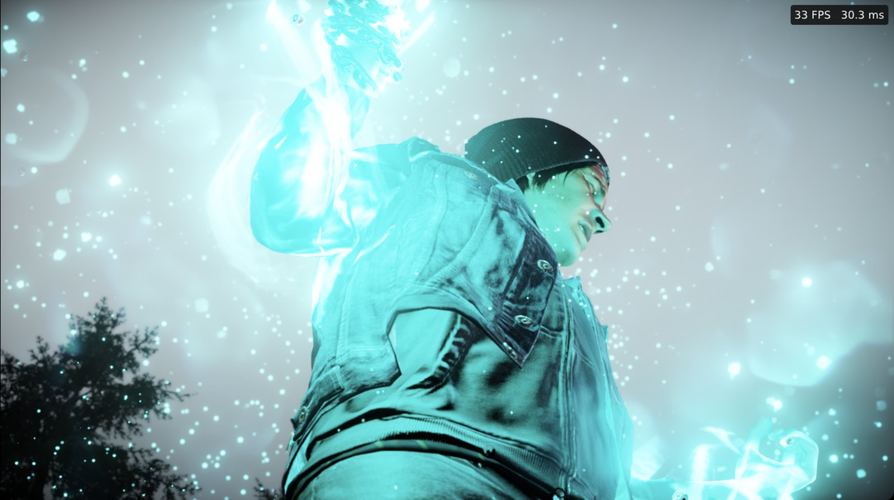
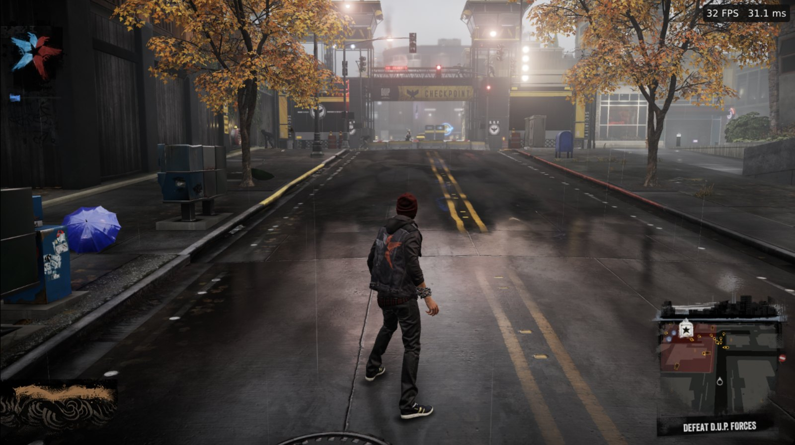

# inFAMOUS Second Son for Apple Silicon Macs

<p align="center"></p>

**inFAMOUS Second Son, running natively on Apple Silicon.** The PS4 game's code is recompiled to
ARM64 ahead of time, so there is no emulator and no Rosetta, and every frame is drawn by a native
Metal renderer.

- **Works well from the start to the Seattle open world**, with the game's lighting, fire, smoke
  and particle effects.
- **30–45 FPS at 1080p** on an M1 Max ([benchmark](#benchmark)).
- **Native ARM64 code:** all of the game's ~46,000 functions, compiled ahead of time.
- **Native Metal renderer:** shaders translated to Metal, compiled in the background and cached.
- **Play your way:** DualShock 4 and DualSense with gyro and touchpad, other controllers, or
  keyboard and mouse.
- **A real Mac app:** installs to Applications and starts from Launchpad or Spotlight, with Game
  Mode.

> **No game files included.** Bring your own copy of the game, dumped from your own PS4. The
> recompiler runs on your Mac and keeps everything it generates in `recomp/work/`, which git
> ignores.

<p align="center"></p>

## Benchmark

| Scene | Average FPS |
|---|---|
| Walk to Seattle | 43 |
| Seattle open world | 35 |
| Cannery | 34 |
| Fire road | 30 |

Apple M1 Max (64 GB), 1920×1080 in a window, vsync on. Each scene is played for about a minute
after loading, with scripted controller input (`recomp/tests/play.sh`). Fullscreen is faster.

## Requirements

- An Apple Silicon Mac with a recent version of macOS.
- Xcode Command Line Tools (`clang`, `swiftc`): `xcode-select --install`.
- [Homebrew](https://brew.sh) packages:
  ```
  brew install cmake ninja pkgconf sdl3 ffmpeg freetype fmt boost robin-map xxhash zydis \
               vulkan-headers vulkan-loader spirv-cross glslang python@3.13
  ```
- **Your own dump of the game** with the 1.07 update merged in (the folder with `eboot.bin`), for
  example CUSA00004 or CUSA00223.
- About 1 GB of free disk space for the generated sources and the build.

## Build and install

```sh
git clone --recursive https://github.com/millennium-h4x0r/iss-macos-arm64-recomp.git
cd iss-macos-arm64-recomp/recomp
GAME="/path/to/your/dump"        # the folder with eboot.bin

# Headers the build expects (not committed)
git clone --depth 1 https://github.com/simd-everywhere/simde third_party/simde
mkdir -p third_party/vma/include
curl -L -o third_party/vma/include/vk_mem_alloc.h \
  https://raw.githubusercontent.com/GPUOpen-LibrariesAndSDKs/VulkanMemoryAllocator/master/include/vk_mem_alloc.h

# 1. Prepare the guest image from your dump
mkdir -p work/out
python3 ../port/scripts/prepare.py         "$GAME" --out work/out
python3 ../port/scripts/link_libc.py       "$GAME" --out work/out
python3 ../port/scripts/link_modules.py    "$GAME" --out work/out
python3 ../port/scripts/content_profile.py "$GAME" --out work/out --sku full

# 2. Recompile the game's code to C (once; again after changing the recompiler)
python3 -m venv work/venv && work/venv/bin/pip install capstone
work/venv/bin/python -I lifter/lift.py work/out/boot-linked.bin "$GAME" work/gen

# 3. Build with the Metal renderer
TLG_METAL=1 ./build.sh

# 4. Install the app ("/Applications/inFAMOUS Second Son.app")
ISS_GAME_DIR="$GAME" ./install-app.sh
```

Start **inFAMOUS Second Son** from Finder, Launchpad or Spotlight. After a rebuild, run
`./install-app.sh` again: the app keeps its own copy of the binary (it refuses while the game is
running).

To run from a terminal instead: `ISS_METAL=1 ISS_GAME_DIR="$GAME" ./run.sh`. If your dump is at
`CUSA00004[Infamous Second Son]/extracted/uroot` next to the repository folder, `ISS_GAME_DIR` is
not needed. `./build.sh runtime` relinks without recompiling the generated code.

## Playing

- **Port menu:** F12, the key left of 1 (Macs have no Insert key), or R3+L2 on a controller.
  Settings are saved to `recomp/work/tlg.ini`.
- **Frame-rate overlay:** F10, or "Show overlay" in the menu.
- **Fullscreen** gives the best frame rate (the menu, or `display_mode=fullscreen` in `tlg.ini`).
- **Saves** are in `recomp/work/user/savedata/`; the log is `recomp/work/game.log`.
- **Native render resolution:** `iss_native_output=1` and `iss_native_percent=<25..100>` in
  `tlg.ini` (or the menu's Native rendering tab) render the 3D scene below 1920x1080 with the HUD
  at full size.
- The game runs as an app bundle on purpose: macOS treats an unbundled binary as a background
  process, evicts its GPU memory and pages it back in under the kernel GPU lock (a desktop-wide
  freeze), and gives it no Game Mode.
- A small guard (`recomp/tests/wsguard.swift`) pauses the game while WindowServer stops
  answering, so a long GPU stall can never reach WindowServer's watchdog, which would restart the
  desktop. `ISS_WSGUARD=0` turns it off.

### Controls

A DualShock 4 or DualSense works as is, including the gyro and the touchpad. Other controllers and
the keyboard simulate both:

| In the game | DualShock 4 / DualSense | Other controllers | Keyboard and mouse |
|---|---|---|---|
| Absorb a power, "hold the touchpad" | hold the touchpad | hold View/Select | hold Tab or Backspace |
| "Press the touchpad" | click the touchpad | tap View/Select | Tab or Backspace |
| Touchpad swipe (doors, hand scanner) | swipe | hold View/Select + right stick | hold Tab + arrow keys |
| Both ends of the touchpad | two fingers | hold View/Select + R1 | hold Tab + Backspace |
| Graffiti: turn the can sideways | turn the controller | L3+R3 (sensor mode) | hold T or G |
| Graffiti: shake / spray | shake / R2 | cross (A) / R2, left stick aims | Y / F, arrow keys aim |
| Back to normal after the graffiti | — | L3+R3 again | — |

The mouse turns the camera; left button is R2, right button L2, middle R3. Esc releases the mouse
and a click in the window captures it again. `ISS_MOTION=off` ignores a real gyro (the simulation
still works).

### Switches for terminal runs

| Variable | Effect |
|---|---|
| `ISS_GAME_DIR=<dir>` | the game folder (with `eboot.bin`) |
| `ISS_METAL=1` | use the Metal build (`recomp/work/iss-recomp-metal`); the app always does |
| `ISS_DIRECT=1` | run the binary directly (debuggers, `sample`) |
| `TLG_METAL_CF_GDS_FLAG_DEFER=0` | faster in heavy scenes, but fires and the smoke form can drop out |
| `TLG_METAL_SHADER_WAIT_MS=<ms>` | how long a frame may wait for new shaders, per second (default 100) |
| `TLG_METAL_HITCH_MS=<ms>` | log frames slower than that, with what they waited for |

## How it works

### Static recompilation

- Every guest function becomes `void F_<offset>(Ctx *c)` in C (~46,000 functions, ~2.5 M
  instructions, ~910 switch tables). Guest registers are C locals, spilled to `Ctx` around
  calls; flags are locals the compiler removes when unused. The guest stack is real memory and
  calls push return addresses as on x86, so stack arguments, varargs and the game's own unwinding
  keep working.
- Indirect calls and jumps go through `recomp_lookup` (a hash of the guest offset); switch tables
  become C `switch`es on the computed target; register and vtable tail calls use `musttail`.
- Imports are fake guest addresses whose thunks call the PS4 runtime through
  `recomp/rt/hostcall.S` (System V to AAPCS64).
- Guest loads and stores (other than stack-relative ones) are acquire/release (`LDAPR`/`STLR`),
  which gives x86's TSO ordering between threads.
- Guest memory sits below the 1 TiB that the game's 40-bit pointers allow: the PS4 user range at
  `0x7000000000-0xe000000000`, the image at `0xe000000000`, guest stacks and TLS from
  `0xe100000000`.

### How the renderer works

The Metal renderer (`port/gpu/metal`) takes the GPU library's PM4 command processing and its GCN
shader recompiler (GCN to SPIR-V), translates the shaders to Metal Shading Language and renders
with Metal.

- **Unified memory:** guest memory is one `MTLBuffer` over the game's own pages, so the GPU
  writes results in place and CPU reads of GPU data need no download.
- **Shaders:** translations and compiled shaders are cached on disk
  (`recomp/work/user/metal-*-cache.bin`). New shaders compile in parallel off the command
  processor, and a frame waits for them within a budget instead of skipping draws, so effects do
  not blink.
- **Encoding:** a separate encoder thread turns the recorded work into Metal command buffers;
  writes to guest memory are ordered with fences, since Metal does not track that buffer.
- **Labels and timing:** the GPU runs about a frame behind the game, while the game waits on GPU
  labels in memory and reuses a job's memory soon after it sees the job's completion flag. Job
  flags are written when the work is recorded (a job seen late is dropped, which gave gray
  frames); timeline counters, and flags after a GPU particle-count copy, are written when the GPU
  has finished (an early count made fires and the smoke form vanish). Small job inputs are copied
  when recorded, and graphics shaders get a short loop guard, so memory the game has already
  reused cannot hang the GPU.

The development log, with the measurements behind each choice, is in
[`recomp/docs/metal-backend.md`](recomp/docs/metal-backend.md).

## Known issues

- The first start after an update compiles shaders: for a few minutes, effects can appear a
  moment late.
- On the walk to Seattle, a frame occasionally comes out gray.

## Repository layout

| Path | What |
|---|---|
| `recomp/lifter/` | the recompiler: image reader, function discovery, switch tables, x86-64 / SSE / AVX / x87 semantics, C emission |
| `recomp/rt/` | the runtime the generated code runs on: CPU state, dispatch, host calls, the loader (`main.c`), macOS stand-ins for Linux/x86 APIs |
| `recomp/build.sh`, `run.sh`, `install-app.sh` | build, run, install as an app |
| `recomp/tests/` | `play.sh` (scripted play routes with frame times and dumps), `semtest/` (lifted instruction semantics against real x86), `wsguard.swift` |
| `port/gpu/metal/` | the Metal renderer |
| `port/src/`, `port/gpu/`, `port/scripts/` | the PS4 runtime, the GPU library and the image preparation scripts |

`recomp/tests/play.sh <route> [seconds] [save]` plays a route (`opening`, `explore`, `dash`,
`roam`, ...) with simulated controller input. A save fixture is a copy of a
`recomp/work/user/savedata` folder kept as `recomp/work/saves/<name>`. The script backs up your own
saves to `recomp/work/saves/auto-backup-*` before swapping them in, and only one run can be active
at a time.

## License

Forked from [HayatoG/iss_pc](https://github.com/HayatoG/iss_pc).

Source files carry their own license headers; the GPU library under `port/gpu`, including the
Metal renderer, is GPL-2.0-or-later.

No game code, assets or keys are distributed here. inFAMOUS is a trademark of Sony Interactive
Entertainment. This project is not affiliated with Sony Interactive Entertainment or Sucker Punch
Productions.
